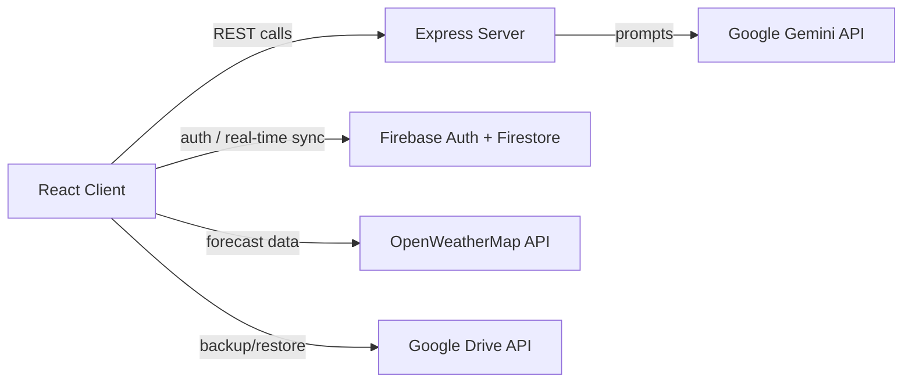

<div align="center">

# 🌾 AgriSeva AI

**A multi-agent AI companion for smallholder farmers across India**

Crop health diagnosis · Weather insights · Mandi market prices · Government schemes · Yield forecasting

[](https://react.dev/)
[](https://www.typescriptlang.org/)
[](https://vitejs.dev/)
[](https://firebase.google.com/)
[](https://ai.google.dev/)

</div>

---

## 📖 Overview

**AgriSeva AI** is a mobile-first web app that gives smallholder farmers in India a team of specialised AI agents in their pocket. Instead of one generic chatbot, farmer queries are routed to the agent best suited to answer them — crop health, weather, market prices, government schemes, or finance — so advice stays short, relevant, and easy to act on.

The app is built with a React/Vite front end and a lightweight Express backend that proxies all requests to the **Google Gemini API**, keeping the API key server-side. User profiles, price alerts, and notifications are synced in real time through **Firebase Authentication** and **Firestore**, with optional backup to Google Drive.

The UI is fully localized in **English, Hindi, and Tamil**.

## ✨ Features

### 🤖 Multi-Agent AI Chat
A single system prompt routes each query to exactly one relevant agent — 🌱 Crop Health, 🌦️ Weather, 📈 Market Price, 🏛️ Government Scheme, or 💰 Finance — keeping replies to 2–3 short, actionable bullet points and filtering out off-topic requests.

### 🔍 Crop Disease Detection
Upload or capture a photo of a crop; Gemini's vision capabilities identify the crop, detect diseases/pests/deficiencies, return a confidence score, and suggest a treatment with dosage, a nearby input shop, and a direct purchase link.

### 🌦️ Weather-Aware Advice
Current conditions, hourly and multi-day forecasts (via OpenWeatherMap) combined with AI-generated irrigation and crop-care advice tailored to the forecast.

### 📈 Market Prices & Alerts
Live mandi price lookups by crop and location, with user-configurable price alerts (above/below a target) and a notification center.

### 🏛️ Government Scheme Eligibility
Checks a farmer's likely eligibility for schemes like PM-KISAN, listing key criteria, required documents, and status — with built-in fallbacks for common schemes when offline.

### 🗓️ Crop Calendar & 🔄 Crop Rotation Planner
AI-generated, month-by-month planting/cultivation/harvesting calendars, and rotation suggestions (with benefits, risks, and reasoning) based on current crop, soil type, and location — both exportable to PDF.

### 📊 Predictive Yield Estimate
Estimates likely yield using a farmer's historical crop data, current crop, farm size, soil type, and live weather.

### 🗺️ Interactive District Map
An SVG map of Indian states/districts showing rainfall and temperature data to help contextualize local advice.

### 🌱 Personalized Crop Tips
Seed rate and NPK (Nitrogen/Phosphorus/Potassium) recommendations tailored to the farmer's profile.

### 🏢 Nearby Agri Offices
Finds nearby agricultural offices/input centers relevant to the farmer's location.

### 🔐 Accounts & Sync
Google Sign-In (Firebase Auth), per-user Firestore data with strict security rules, and one-click backup/restore to Google Drive.

### 🌐 Multi-language
Full UI and AI-response localization across **English, Hindi (हिन्दी), and Tamil (தமிழ்)**.

## 🛠️ Tech Stack

| Layer | Technology |
|---|---|
| Frontend | React 19, TypeScript, Vite 6, Tailwind CSS 4 |
| UI / UX | Framer Motion (`motion`), `lucide-react`, `react-markdown`, Recharts |
| Backend | Express, `tsx` (dev), esbuild (production bundle) |
| AI | Google Gemini (`@google/genai`, `gemini-3.5-flash`) |
| Auth & Database | Firebase Authentication, Cloud Firestore |
| Weather Data | OpenWeatherMap API |
| PDF Export | jsPDF |
| Cloud Backup | Google Drive API |

## 📂 Project Structure

```
agentic/
├── server.ts                        # Express server – hosts Gemini API routes & serves the app
├── index.html                       # App entry point
├── firebase-applet-config.json      # Firebase client config
├── firestore.rules                  # Firestore security rules
├── metadata.json                    # App metadata (name, description, capabilities)
├── src/
│   ├── App.tsx                      # Main app shell, screens, and navigation
│   ├── main.tsx                     # React root
│   ├── firebase.ts                  # Firebase init (Auth + Firestore)
│   ├── types.ts                     # Shared TypeScript types
│   ├── TranslationContext.tsx       # i18n provider (en / hi / ta)
│   ├── components/
│   │   ├── InteractiveDistrictMap.tsx
│   │   └── PersonalizedCropTips.tsx
│   ├── services/
│   │   ├── gemini.ts                # Client-side API wrappers (calls the Express backend)
│   │   └── gemini-backend.ts        # Server-side Gemini prompts & logic
│   ├── utils/
│   │   ├── googleDrive.ts           # Backup/restore to Google Drive
│   │   └── pdfExport.ts             # Crop calendar / rotation PDF export
│   └── lib/utils.ts
├── package.json
├── tsconfig.json
└── vite.config.ts
```

## 🏗️ Architecture



All Gemini calls happen server-side (`src/services/gemini-backend.ts`, exposed via `server.ts`), so the `GEMINI_API_KEY` never reaches the browser.

## 🚀 Getting Started

### Prerequisites
- Node.js 18+
- npm
- A [Google Gemini API key](https://ai.google.dev/)
- A Firebase project (Authentication + Firestore enabled) if you want auth/sync features
- An [OpenWeatherMap API key](https://openweathermap.org/api) for weather data

### Installation

```bash
git clone https://github.com/harishV2005/agentic.git
cd agentic
npm install
```

### Environment Variables

Copy `.env.example` to `.env` and fill in your keys:

```bash
cp .env.example .env
```

| Variable | Description |
|---|---|
| `GEMINI_API_KEY` | Google Gemini API key, used server-side for all AI features |
| `APP_URL` | The URL your app is hosted at (used for self-referential links / callbacks) |
| `VITE_OPENWEATHER_API_KEY` | OpenWeatherMap API key for live weather data |

You'll also need to populate `firebase-applet-config.json` with your Firebase web app config for Authentication and Firestore to work.

### Run in Development

```bash
npm run dev
```

The app runs on **http://localhost:3000** (Express serves the Vite dev middleware).

### Build for Production

```bash
npm run build
npm start
```

### Other Scripts

| Command | Description |
|---|---|
| `npm run dev` | Start the dev server (Vite + Express, hot reload) |
| `npm run build` | Build the client with Vite and bundle the server with esbuild |
| `npm start` | Run the production build (`dist/server.cjs`) |
| `npm run clean` | Remove the `dist/` folder |
| `npm run lint` | Type-check the project (`tsc --noEmit`) |

## 🔐 Firebase Setup

1. Create a Firebase project and enable **Authentication** (Google provider) and **Cloud Firestore**.
2. Copy your web app config into `firebase-applet-config.json`.
3. Deploy the included `firestore.rules` to enforce per-user data access (profiles, price alerts, notifications, and crop history are all scoped to the authenticated user's UID).

```bash
firebase deploy --only firestore:rules
```

## 🌐 Supported Languages

| Language | Code |
|---|---|
| English | `en` |
| हिन्दी (Hindi) | `hi` |
| தமிழ் (Tamil) | `ta` |

## 🤝 Contributing

Contributions are welcome! Please open an issue to discuss significant changes before submitting a pull request.

1. Fork the repository
2. Create a feature branch (`git checkout -b feature/your-feature`)
3. Commit your changes
4. Push to the branch and open a Pull Request

## 📄 License

No license has been specified for this project yet. Consider adding a `LICENSE` file (e.g. MIT) to clarify how others can use this code.

## 🙏 Acknowledgments

- Built with [Google AI Studio](https://ai.studio/) — generated from the `google-gemini/aistudio-repository-template`.
- Powered by the [Google Gemini API](https://ai.google.dev/).
- Weather data via [OpenWeatherMap](https://openweathermap.org/).
